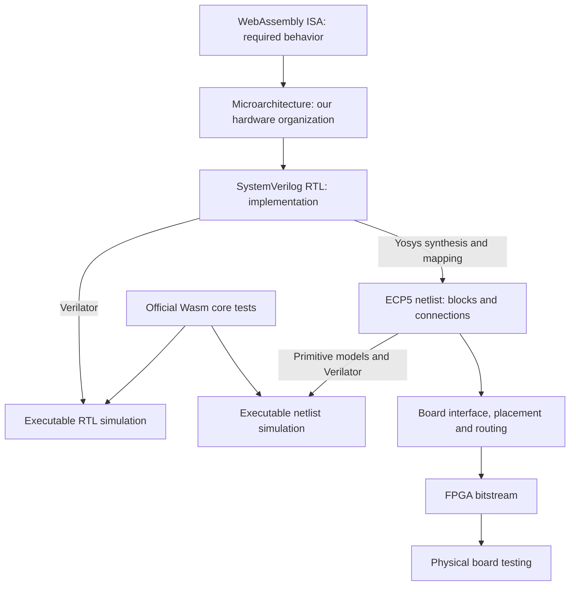

# From the Wasm specification to an FPGA

WasMetal is one processor design represented and checked at several levels. The microarchitecture, RTL and SystemVerilog are closely related descriptions of that design; they are not three different processors.

| Term | Meaning in WasMetal |
|---|---|
| **ISA** | The instruction set architecture: the operations and observable behavior defined by WebAssembly. It specifies what a program means. |
| **Microarchitecture** | Our choices for how to execute that ISA: a stack machine, banked storage, shared arithmetic units, serialized SIMD, control states and memory interfaces. |
| **RTL** | Register-transfer-level description: what state is stored and how logic computes the next state between clock edges. This is a way of describing hardware. |
| **SystemVerilog** | The language used to write that RTL. It can also describe test benches and constructs that are not synthesizable hardware. |
| **RTL simulation** | A program evaluates our RTL's behavior as clocks and inputs change. Verilator generates and compiles this model from the SystemVerilog. |
| **Synthesis** | Yosys transforms the RTL into hardware building blocks. Technology mapping selects blocks available in the target FPGA. |
| **Netlist** | The resulting list of hardware instances, their settings and their connections. The ECP5 netlist contains lookup tables, carry logic, flip-flops, RAM and multipliers. |
| **Netlist simulation** | Simulation of those interconnected blocks, using models of the FPGA primitives. We also use Verilator for this stage. |
| **Placement and routing** | Tools assign blocks to locations in a particular FPGA and select physical routing resources connecting them. |
| **Bitstream** | Configuration data that programs an existing FPGA's logic, memory modes and routing. It does not manufacture a new chip. |
| **Physical hardware testing** | Load that configuration into an actual board, send programs and check results under real clocks, power supplies and interfaces. |

The microarchitecture is embodied in the SystemVerilog RTL. There is no required separate compilation step called “compile the microarchitecture into RTL”; implementing the microarchitecture is the design work we do when writing that RTL.



## The two simulation models

Verilator translates a hardware description into C++ and builds an executable simulation. That executable represents signals, registers, memories and their changes over simulated clock cycles. It runs on the development computer.

The surrounding C++ adapter supplies clocks, instructions, metadata and backing storage. Wasm instruction results come from the simulated processor. The Python runner keeps expected results separately and compares them with the outputs. A Wasm software interpreter does not substitute results for the execution engine.

For RTL simulation, Verilator receives the original SystemVerilog modules. For netlist simulation, it receives the synthesized circuit and models of its FPGA building blocks. These are two simulation executables with the same CPU interface, not two separately designed CPUs.

Both use the same software loading/validation boundary. `wasm-tools` validates modules; Python decodes binaries and prepares their execution images. A core test-corpus pass includes separately counted execution, validation and embedding assertions. It does not mean all those responsibilities moved into RTL.

## Why simulate after synthesis

An addition in RTL becomes a network of logic and carry cells. An RTL memory array must map to FPGA RAM with the right clock edges, addressing and write masks. Synthesis also restructures and optimizes logic.

The original RTL can simulate correctly while a tool translation, primitive configuration, RAM inference or simulation model has a bug. Netlist simulation checks the translated representation against the same external program expectations.

The ECP5 simulator uses Yosys logic-cell models plus checked models for the emitted RAM and multiplier configurations. The [builder](../tools/build_gate_sim.py) rejects unknown primitive types or unsupported configurations and records exact inputs and executable hashes.

This is **functional** simulation. It checks values and clocked behavior, not analog electrical behavior or realistic routed wire delays. Static timing analysis separately checks whether signals can arrive before their required clock edges. Both rising and falling edges matter to WasMetal's RAM design.

## Why the previous reports said 259 and 40

The full original-RTL run completed all **259** pinned official core test files, with 57,711 execution assertions, 4,677 validation assertions and 254 embedding assertions. See the [recorded RTL run](verification/core-3.0-current.json).

The additional netlist regression selected **40** files and completed 17,379 execution assertions. Its report explicitly records `full_core_suite_passed: false`, because it is a subset. It uses the same core netlist as the default routed ULX3S bitstream. See the [recorded mapped run](verification/ecp5-abc9.json).

That record does not establish failures in the remaining files; it establishes that the full mapped regression was not completed. The mapped simulation evaluates a much more detailed circuit and can take substantially longer. The direct and reference tail-call suites alone account for over 210 million simulated cycles in the recorded RTL run; their official long-running cases must remain intact.

The full mapped regression is now in progress. Its final result must identify all 259 suites, show zero failures, unsupported cases, conversion errors, blocked commands or runner errors, and pass executable/source identity checks. No full mapped pass is claimed until that report exists.

## Running and observing the full mapped regression

For a freshly built model in the current workspace:

```sh
make fpga-core
python3 tools/build_gate_sim.py --core-netlist build/core-ecp5.json
python3 tools/run_spec.py \
  --simulator build/gate-model/obj/Vwasmetal_core \
  --wait-states 3 --jobs 8 --response-timeout 172800 \
  --schedule-from docs/verification/core-3.0-current.json \
  --progress-report reports/ecp5-full.progress.json \
  --report reports/ecp5-full.json
```

Omitting `--suite` selects the entire official core tree. `--schedule-from` changes only execution order, using prior cycle counts to start long suites early. Each suite has its own simulator process and independent state.

`--response-timeout` sets the wall-clock deadline for a simulator response. The separate simulated-cycle budget is unchanged. Wall timeouts, cycle timeouts and unsupported instructions remain failures; they cannot satisfy an expected Wasm exhaustion assertion.

The progress file is replaced atomically when a suite finishes. It is a partial observation, never evidence of a full pass. The final report is authoritative and follows the end-of-run identity checks. `--verbose` additionally logs the script location before each command, identifying long invocations while they run.

The current long run reuses the verified executable under `build/abc9-check/root`, preserving its build environment. Its netlist is byte-identical to `build/core-ecp5.json`, and its RTL and host-adapter inputs match the current project. The current runner was copied into that snapshot before launch. Local launch details are in `reports/ecp5-full-launch.json`; live results go to the root workspace's `reports/` directory. Historical synthesis/routing scripts in the snapshot are not used to execute the simulation.

## After a full netlist pass

A full netlist pass would establish that the synthesized functional model passes the same official corpus as the RTL model. It would not establish a mathematical proof for every possible program, a transistor-level simulation or a physical-board result.

WasMetal has a routed ULX3S bitstream with recorded timing checks. Physical programming, board bring-up and on-board tests remain separate milestones. An ASIC is another implementation target: synthesis and physical design use a chip process's cell and memory libraries, followed by manufacturing, packaging and silicon testing.
