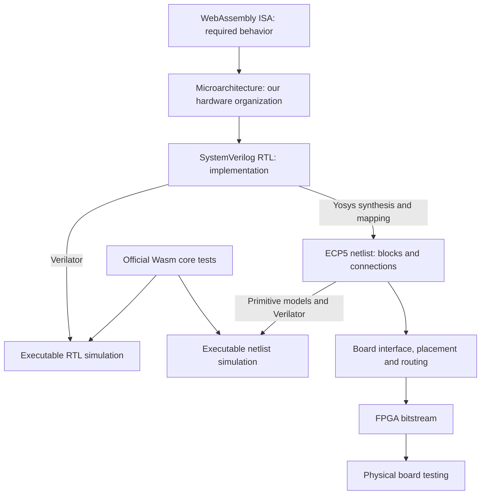

# From the Wasm specification to an FPGA

WasMetal is one processor design represented and checked at several levels. The microarchitecture, RTL and SystemVerilog are closely related descriptions of that design; they are not three different processors.

| Term | Meaning in WasMetal |
|---|---|
| **ISA** | The instruction set architecture: the operations and observable behavior defined by WebAssembly. It specifies what a program means. |
| **Microarchitecture** | Our choices for how to execute that ISA: a stack machine, banked storage, shared arithmetic units, serialized SIMD, control states and memory interfaces. |
| **RTL** | Register-transfer-level description: what state is stored and how logic computes the next state between clock edges. This is a way of describing hardware. |
| **SystemVerilog** | The language used to write that RTL. It can also describe test benches and constructs that are not synthesizable hardware. |
| **RTL simulation** | A program evaluates our RTL's behavior as clocks and inputs change. Verilator generates and compiles this model from the SystemVerilog. |
| **Synthesis** | Yosys transforms the RTL into hardware building blocks. Technology mapping selects blocks available in the target FPGA. |
| **Netlist** | The resulting list of hardware instances, their settings and their connections. The ECP5 netlist contains lookup tables, carry logic, flip-flops, RAM and multipliers. |
| **Netlist simulation** | Simulation of those interconnected blocks, using models of the FPGA primitives. We also use Verilator for this stage. |
| **Placement and routing** | Tools assign blocks to locations in a particular FPGA and select physical routing resources connecting them. |
| **Bitstream** | Configuration data that programs an existing FPGA's logic, memory modes and routing. It does not manufacture a new chip. |
| **Physical hardware testing** | Load that configuration into an actual board, send programs and check results under real clocks, power supplies and interfaces. |

The microarchitecture is embodied in the SystemVerilog RTL. There is no required separate compilation step called “compile the microarchitecture into RTL”; implementing the microarchitecture is the design work we do when writing that RTL.

RTL describes both registers and memory accesses. WasMetal's value stack maps to FPGA block RAM; the RTL describes the control logic that selects entries to read and write on clock edges.



## The two simulation models

Verilator translates a hardware description into C++ and builds an executable simulation. That executable represents signals, registers, memories and their changes over simulated clock cycles. It runs on the development computer.

The surrounding C++ adapter supplies clocks, instructions, metadata and backing storage. Wasm instruction results come from the simulated processor. The Python runner keeps expected results separately and compares them with the outputs. A Wasm software interpreter does not substitute results for the execution engine.

For RTL simulation, Verilator receives the original SystemVerilog modules. For netlist simulation, it receives the synthesized circuit and models of its FPGA building blocks. These are two simulation executables with the same CPU interface, not two separately designed CPUs.

Both use the same software loading/validation boundary. `wasm-tools` validates modules; Python decodes binaries and prepares their execution images. A core test-corpus pass includes separately counted execution, validation and embedding assertions. It does not mean all those responsibilities moved into RTL.

## Why simulate after synthesis

An addition in RTL becomes a network of logic and carry cells. An RTL memory array must map to FPGA RAM with the right clock edges, addressing and write masks. Synthesis also restructures and optimizes logic.

The original RTL can simulate correctly while a tool translation, primitive configuration, RAM inference or simulation model has a bug. Netlist simulation checks the translated representation against the same external program expectations.

The ECP5 simulator uses Yosys logic-cell models plus checked models for the emitted RAM and multiplier configurations. The [builder](../tools/build_gate_sim.py) rejects unknown primitive types or unsupported configurations and records exact inputs and executable hashes.

This is **functional** simulation. It checks values and clocked behavior, not analog electrical behavior or realistic routed wire delays. Static timing analysis separately checks whether signals can arrive before their required clock edges. Both rising and falling edges matter to WasMetal's RAM design.

Simulation speed is also different from hardware clock speed. A computer may take milliseconds to evaluate one cycle of the mapped circuit. The configured FPGA carries out its circuit's operations in parallel. A slow simulator does not establish a slow FPGA clock; the recorded timing constraints and physical measurements address that question.

## Why the previous reports said 259 and 40

The full original-RTL run completed all **259** pinned official core test files, with 57,711 execution assertions, 4,677 validation assertions and 254 embedding assertions. See the [recorded RTL run](verification/core-3.0-current.json).

The initial netlist regression selected **40** files and completed 17,379 execution assertions. Its report explicitly records `full_core_suite_passed: false`, because it is a subset. It uses the same core netlist as the default routed ULX3S bitstream. See the [initial mapped run](verification/ecp5-abc9.json).

That historical record did not establish failures in the remaining files; it established that the full mapped regression had not been completed. The mapped simulation evaluates a much more detailed circuit and can take substantially longer. The direct and reference tail-call suites alone account for over 210 million simulated cycles; their official long-running cases remained intact.

The [final full mapped run](verification/ecp5-full.json) now passes **all 259 suites**, including the long stress cases. It records 57,711 execution assertions, 4,677 validation assertions, 254 embedding assertions and 306,351,688 cycles, with exact per-suite agreement against the original RTL. Final executable/source identity checks passed. There were no failures, unsupported cases, conversion errors, blocked commands or runner errors.

## Running and observing the full mapped regression

For a freshly built model in the current workspace:

```sh
make fpga-core
python3 tools/build_gate_sim.py --core-netlist build/core-ecp5.json --fast-sim --fast-luts
python3 tools/run_spec.py \
  --simulator build/gate-model/obj/Vwasmetal_core \
  --wait-states 3 --jobs 4 --response-timeout 172800 \
  --schedule-from docs/verification/core-3.0-current.json \
  --progress-report reports/ecp5-full.progress.json \
  --report reports/ecp5-full.json
```

The optional `--fast-sim` builder flag uses Clang with `-O3 -march=native` for
the simulator executable. It changes neither the netlist nor the FPGA
bitstream. It requires Clang and targets the development computer's instruction
set, so rebuild the simulator when moving to a different host CPU. The builder
option `--portable` instead selects the compiler's baseline CPU target; CI uses
this to share one executable between workers with different host processors.
Compiler identity and flags are recorded; a full build recompiles every object to avoid
silently reusing objects from different compiler settings. `--jobs` controls
compilation parallelism, and `--build-directory build/gate-fast` keeps an
experimental executable separate from an existing one.

`--fast-luts` expresses each lookup table as a direct lookup when its selectors
are known, retaining the original multiplexer expression whenever a selector is
X or Z. This changes the simulation representation of the primitive, not the
mapped circuit. Each build first proves binary equivalence for every possible
table and selector and runs four-state comparisons for the mapped table values.
A deliberately wrong primitive must fail the proof. See the
[primitive-check report](verification/ecp5-lut-model.json). These are local
primitive checks, separate from the inconclusive whole-CPU equivalence attempt.

Omitting `--suite` selects the entire official core tree. `--schedule-from` changes only execution order, using prior cycle counts to start long suites early. Each suite has its own simulator process and independent state.

`--response-timeout` sets the wall-clock deadline for a simulator response. The separate simulated-cycle budget is unchanged. Wall timeouts, cycle timeouts and unsupported instructions remain failures; they cannot satisfy an expected Wasm exhaustion assertion.

CI includes regression checks for timeout classification and for recompiling simulator objects when compiler flags change.

## Checking the programmable wrapper mapping

The programmable wrapper uses ABC9, as the CPU already does. The
[board-wrapper comparison](verification/loadable-mapping-proof.json) independently
maps the same synthesis input with ABC. It requires matching configurations for
all 1,693 registers, 94 block RAMs, 64 distributed RAMs and the unchanged CPU
instance. Register matching uses RTL signal names, excluding generated
technology aliases, and must account for every state element exactly once.

The proof replaces those elements' outputs with 5,865 arbitrary shared binary
inputs. It then proves equality of 15,976 bits: every input to those elements
and every external output. A deliberately inverted external output must fail.
This checks the combinational logic between state elements under identical
state/CPU outputs; it is not a formal proof of the CPU, clock timing or
metastability behavior. The separate four-state primitive checks still apply.
The [accelerated simulation configuration](verification/loadable-simulation-mapping-proof.json)
also passes, comparing 15,892 bits around 1,668 registers and the same memory
and CPU instances. CI requires both configurations to pass.

```sh
python3 tools/build_loadable_board.py --map-only
python3 tools/prove_loadable_mapping.py
# After the accelerated simulation mapping has been built:
python3 tools/prove_loadable_mapping.py --directory build/loadable-mapped
```

The board mapper explicitly preserves the attributed reset chain before ABC9.
The I/O audit requires real register drivers for its named stages and rejects
an undriven stage as well as bypassed synchronization and incorrect clocks or
reset polarity.

## What CI runs

The [CI workflow](../.github/workflows/rtl.yml) builds the original SystemVerilog
RTL with `make sim`. Both official-suite commands use that executable by default.

| Check | Automated in current CI? |
|---|---|
| Full official corpus on the original RTL, normal memory responses | Yes; [passed](verification/ci-native-fast.json) |
| Full official corpus on the original RTL, three memory wait states | Yes; [passed](verification/core-3.0-current.json) |
| Full official corpus on the synthesized ECP5 CPU netlist | Yes; [passed](verification/ci-mapped-complete.json) |
| Mapped-RAM component checks and the RTL board/UART simulation | Yes |
| Bounded standalone images, local-memory oracle and autonomous board RTL | Yes; separate standalone job |
| Complete standalone mapped circuit compared with board RTL | Yes; prepared self-test and reset scenarios |
| Standalone placement/routing timing and bitstream round trip | Yes; separate standalone-routing job |
| Programmable uploads, replacement and recovery | Yes; all 35 local RTL/mapped comparisons passed |
| Compiled freestanding C through programmable uploads | Yes; all five local RTL/mapped comparisons passed |
| Programmable placement/routing and bitstream round trip | Required by CI; routing has not completed locally |
| Wide memory, AXI, clock crossing and SRAM adapter checks | Yes; component proofs, RTL and mapped simulations |
| Complete CPU through SRAM adapter and behavioral macro | Yes; separate RTL job at two read latencies, with a corrupt-read control |

The [programmable integration flow](PROGRAM-UPLOAD.md) requires all six mapped
groups, native tests, the compiled C workload and board routing. Its execution
results are complete locally; programmable routing remains unresolved. These
jobs supplement the complete official core corpus with bounded system tests.

The standalone functional job runs the RTL tests, synthesizes the bounded CPU,
maps the board with `--map-only`, and runs the memory-model and complete mapped
system comparisons. It shares that CPU mapping with the programmable tests
and a separate standalone routing job. Routing still requires timing closure
and a bitstream round trip; its success is not needed to start the functional
comparisons. Reports, and successful bitstreams with their prepared images,
are retained for 30 days. The existing `Standalone FPGA system` check name
is retained as a gate requiring both jobs, preserving its physical-success
requirement. Its local-memory integration coverage
does not replace or claim the entire official corpus on the standalone system.
This separation addresses [the selector build's three-hour routing timeout](https://github.com/Millillion/wasmetal/actions/runs/41770401814/job/126379123153),
which previously prevented the mapped standalone and programmable tests from
starting. The physical implementation of that revision remains unverified.
See the [standalone guide](STANDALONE.md) for capacities and recorded evidence.
Its [first clean CI job passed](https://github.com/Millillion/wasmetal/actions/runs/41572176563/job/125707382260)
and reproduced the local bitstream exactly; the [receipt](verification/standalone-ci.json)
records verified artifact hashes and all local/CI UART-frame and clock comparisons.

After the original RTL passes, CI synthesizes the production ECP5 core and builds
one portable mapped simulator. Sixteen workers execute the complete official
corpus with three memory wait states. The executable, build inputs and manifests
travel together in a tar archive, preserving executable permissions and allowing
each worker to verify the exact model before and after its tests.

GitHub-hosted jobs have a [six-hour limit](https://docs.github.com/en/actions/reference/limits).
The longest tail-call script exceeded that limit locally. The runner therefore
partitions three reviewed tail-call scripts by original script command; every
other script runs intact. It preserves all official assertions, arguments and
million-iteration stress cases. Static admission checks require immutable module
state, no memory or start function, no state-changing instructions, and only the
verified empty `spectest.print_i32_f32` import. Unknown commands or instructions
fail admission. Stateful scripts are never partitioned this way.

Workers replay the immutable module setup to establish the same function and
table context. Each original command has one owner; repeated setup is reported
separately. Fixture initialization cycles belong to command zero in the canonical
trace. Both canonical and actual simulated cycles are recorded, so repeated
setup cannot inflate assertion counts or disappear from the accounting.

`tools/spec_ci.py` creates the ownership plan from a fresh complete native run.
Measured cycles choose worker placement only. The `Complete mapped corpus` job
requires all workers to succeed and rejects missing/duplicated commands, suites
or shards; altered plans; source/model identity mismatches; failures, unsupported
cases and timeouts; or differences from native counts and per-command cycles.
Only that complete aggregate can set `full_core_suite_passed` to true. Negative
regression tests exercise these rejection paths.

A [full native rehearsal](verification/ci-partitions.json) ran all sixteen
ownership groups and reproduced the intact reference's 65,353 commands, all
per-command cycles and every suite's counts. Replayed initialization added 5,088
cycles, accounted for separately. Feeding those successful native results to
the mapped aggregate correctly failed its backend check. A separate short
synthetic-script regression exercises module, global and table initialization,
calls and traps on both actual simulator executables.

The [complete CI run](https://github.com/Millillion/wasmetal/actions/runs/41470404770)
passed all nineteen jobs, including all sixteen mapped partitions and the final
aggregate. Its [verification record](verification/ci-complete.json) binds the
source revision, models and reports. Independent local aggregation reproduced
the CI result exactly after relocating only the sixteen downloaded report paths.
All 259 suites and 65,353 original commands match native counts and command
cycles. The mapped runs executed 306,351,688 canonical cycles plus 5,088 repeated
setup cycles, for 306,356,776 actual cycles. CI synthesis reproduced the local
production netlist byte-for-byte after replacing only workspace paths in source
annotations.

The SIMD-selector revision at `2c2f527` also passes all sixteen mapped
partitions and the complete coverage check in [CI run 41770401814](https://github.com/Millillion/wasmetal/actions/runs/41770401814).
Its [reconciliation record](verification/ci-selector-complete.json) verifies
all 259 suites, both native configurations, the packaged simulator and all 242
additional build inputs. Local reaggregation reproduces the CI report after
relocating only report paths. Local and CI netlists are identical after 97,769
workspace-path relocations. The native reports, partition plan, all sixteen
partition reports and aggregate are archived in
[verification/ci-selector](verification/ci-selector), beyond GitHub's retention
window. A [corrupted aggregate is rejected](verification/core-ci-reconcile-negative.json),
and a failed reconciliation removes its previous success report.

The complete workflow did **not** pass: the standalone physical build reached
its three-hour limit, so dependent programmable checks were skipped. The
standalone functional/physical separation described above addresses that CI
dependency. It does not make the physical build pass.

To independently reconcile a newly downloaded run at its matching source
revision, save its GitHub API run/jobs/artifact metadata as `github.json` beside
the `gh run download` artifact subdirectories, then run:

```sh
python3 tools/check_core_ci.py --directory build/ci-download \
  --local-netlist build/core-ecp5.json --output reports/core-ci-reconciliation.json
```

CI retains native, individual worker and final aggregate JSON reports for
30 days, and the larger simulator archive for seven days. Mapped-RAM component
checks and UART RTL simulation
remain additional checks with their own scope.
A rerun replaces a job's named artifact when it uploads reports; consult the
latest job result. Earlier attempt logs remain available in the workflow history.

## Progress and independent checks

The progress file is replaced atomically when a suite finishes. It is a partial observation, never evidence of a full pass. The final report is authoritative and follows the end-of-run identity checks. `--verbose` additionally logs the script location before each command, identifying long invocations while they run.

An independent expanded run used the Clang-compiled executable under
`build/abc9-check/root/build/gate-speed`, preserving the verified model's build
environment. Its netlist is byte-identical to `build/core-ecp5.json`, and its RTL
and host-adapter inputs match the current project. The current runner was copied
into that snapshot before launch. It passed the same 249 suites using the
original primitive expressions, with every per-suite count identical to the
optimized lookup model; see the [independent report](verification/ecp5-compiler-only.json).
Local launch details for the interrupted full run
remain in `reports/ecp5-full-launch.json`. Historical synthesis/routing scripts
in the snapshot are not used to execute the simulation.

The equivalent lookup model under
`build/abc9-check/root/build/gate-lookup-clang` completed all 249 selected suites.
Its final report is committed as `docs/verification/ecp5-expanded.json`.
The production builder also completed a fresh `--fast-sim --fast-luts` executable
under `build/gate-fast-lut`. It passes the existing engine boundary and negative
checks, including wrong results, wrong traps, resource exhaustion and timeout
classification; see the [engine report](verification/ecp5-production-engine.json).
It also passed the original [40 official suites](verification/ecp5-production.json)
with exactly the same assertions and cycles as both the native RTL and the
historical mapped run. These overlapping runs do not add distinct suite coverage.
The separate [`call_indirect` run](verification/ecp5-call-indirect.json) also
passed, adding 134 execution assertions, 35 validation assertions and 3,269,242
cycles with exact agreement against the original RTL.

## Completed full regression

The full mapped run finished on 2026-11-02 at 13:31 UTC, after 29,643 seconds
(8 hours 14 minutes), using four workers and longest-first scheduling. All 259
suites completed on the production-built simulator. The final reference-tail-call
suite alone used 120,037,180 cycles, illustrating why suite counts did not measure
remaining runtime. The [completed checkpoint](verification/mapped-regression-status.json)
identifies the final report and exact executable and netlist hashes. Historical
partial reports are retained as observations, superseded by the final result.

The completed command was:

```sh
python3 tools/run_spec.py --simulator build/gate-fast-lut/obj/Vwasmetal_core --wait-states 3 --jobs 4 --response-timeout 172800 --schedule-from docs/verification/core-3.0-current.json --verbose --progress-report reports/ecp5-full-20261102.progress.json --report reports/ecp5-full-20261102.json
```

To reproduce the run when that build directory is unavailable, use the fresh-build
instructions above. The runner checks source and executable identities before and
after execution. The local log is `reports/ecp5-full-20261102.log`. CI run
[41448519089](https://github.com/Millillion/wasmetal/actions/runs/41448519089)
also passed the original-RTL workflow; it did not execute the mapped full run.

## After a full netlist pass

This full netlist pass establishes that the synthesized functional model passes the same pinned official corpus as the RTL model. It does not establish a mathematical proof for every possible program, a transistor-level simulation or a physical-board result.

WasMetal has a routed ULX3S bitstream with recorded timing checks. Physical programming, board bring-up and on-board tests remain separate milestones. An ASIC is another implementation target: synthesis and physical design use a chip process's cell and memory libraries, followed by manufacturing, packaging and silicon testing.
