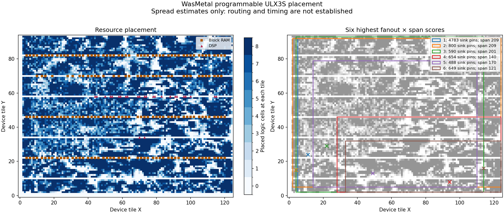

# Programmable-system placement investigation

The direct-rounding build places 61,344 logic cells, 6,958 flip-flops,
192 block RAMs and 26 multipliers on ULX3S 85F. Routing remains incomplete.
The [analysis report](research/rounding-placement.json) identifies the actual
placed circuit and its source inputs. This is placement evidence, with no
completed routing, timing or physical-board result.



The diagram counts placed logic cells at each device tile; empty regions can
contain dedicated resources rather than available logic sites. The rectangles
show the endpoint bounds of six signals. They are not actual routes.

The largest ordinary logic net by sink count is `system.execution.core_reset`:
one LUT drives 4,783 pins over a bounding box spanning 209 tiles in Manhattan
half-perimeter. The next reset-related signal drives 800 pins over the same
span. Descriptor outputs also have substantial fanout: the first bits of the
two descriptor-read buses reach 649 and 654 pins respectively.

These measurements identify candidates for experiments. They do not establish
which net causes the router's resource conflicts. The score in the report is
simply sink-pin count multiplied by bounding-box half-perimeter; it is not a
wire-length, delay or congestion model. Global clock and constant nets are
reported separately. Resource categories use instance names, which packing
can partially obscure.

The next isolated experiment duplicates the existing combinational reset LUT
for spatial groups of sinks. Each copy must have identical inputs and truth
table, with unchanged state primitives, clocks and reset latency. A structural
comparison must account for every changed connection and reject corrupted
copies before any placement/routing result is considered. Whether this reduces
congestion must be measured; extra reset nets can also make placement harder.

Reset distribution needs care on this device. Lattice documents a silicon
startup problem when certain high-initialized reset or enable signals use the
primary low-skew clock network, along with avoidance and startup-workaround
options. The bulletin concerns Diamond-generated designs; it provides a reason
to preserve ordinary fabric routing for these reset experiments.
See [Lattice PB230301, revision 1.1](https://www.latticesemi.com/view_document?document_id=53855).
The pinned [nextpnr global-routing implementation](https://github.com/YosysHQ/nextpnr/blob/5e1b0f15fe6fa167af21f071f7e249b5fa3554a1/ecp5/globals.cc)
selects clock consumers for automatic promotion and keeps ordinary logic
consumers on their existing nets. The current placement uses global distribution
for clocks; the reset net measured above remains on ordinary routing.

To reproduce the diagnostics after a completed placement:

```sh
python3 tools/analyze_placement.py \
  --placement build/loadable-ulx3s/placed.json \
  --manifest build/loadable-ulx3s/design.manifest.json \
  --report reports/placement-analysis.json \
  --figure build/placement.png
```

The optional figure requires Matplotlib and NumPy. Without `--figure`, the
analysis uses the Python standard library. The report checks source and artifact
hashes before and after analysis. Its geometry and exclusion rules have also
been checked against a small independently calculated fixture, including
rejection of missing placement locations.
