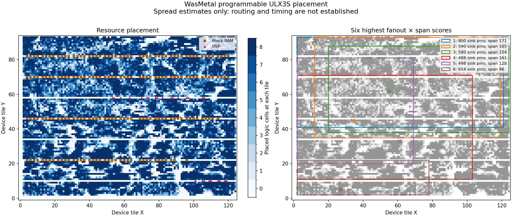

# Programmable-system placement investigation

The direct-rounding build places 61,344 logic cells, 6,958 flip-flops,
192 block RAMs and 26 multipliers on ULX3S 85F. Routing remains incomplete.
The [analysis report](research/rounding-placement.json) identifies the actual
placed circuit and its source inputs. This is placement evidence, with no
completed routing, timing or physical-board result.


The diagram counts placed logic cells at each device tile; empty regions can
contain dedicated resources rather than available logic sites. The rectangles
show the endpoint bounds of six signals. They are not actual routes.

The largest ordinary logic net by sink count is `system.execution.core_reset`:
one LUT drives 4,783 pins over a bounding box spanning 209 tiles in Manhattan
half-perimeter. The next reset-related signal drives 800 pins over the same
span. Descriptor outputs also have substantial fanout: the first bits of the
two descriptor-read buses reach 649 and 654 pins respectively.

These measurements identify candidates for experiments. They do not establish
which net causes the router's resource conflicts. The score in the report is
simply sink-pin count multiplied by bounding-box half-perimeter; it is not a
wire-length, delay or congestion model. Global clock and constant nets are
reported separately. Resource categories use instance names, which packing
can partially obscure.

The isolated [reset-replication experiment](verification/reset-replication.json)
duplicates the existing combinational reset LUT for spatial groups of sinks.
Exact structural substitution proves that all 31 extra LUTs have the original
inputs and truth table and accounts for every changed connection. All 4,783
sinks remain connected, with at most 150 per copy. Five injected defects are
rejected: a changed truth table, changed input, aliased output, disconnected
sink and altered register reset value. State and clock cycles are unchanged.

The [new placement](research/reset-placement.json) retains all 31 additional
logic cells, giving 61,375 logic cells and the same 6,958 registers, 192 block
RAMs and 26 multipliers. The final placer wire-length cost drops from 580,975
to 539,773, a [7.1% reduction](verification/reset-placement-comparison.json).
Both use the same pinned placer, device and seed. This cost is measured before
routing; it does not establish shorter physical routes or better timing.



The original routing trial was [retired incomplete](verification/rounding-routing-retirement.json)
after its best 29,956 conflicting wires increased to 32,138 over three further
iterations. This bounded run does not establish that routing the baseline is
impossible. The reset-replicated candidate's
[router2 trial](verification/reset-replication-router2-retired.json) reached
23,415 conflicting wires at iteration 11, followed by five worsening iterations
to 27,281 at iteration 16. Its [complete routing log](verification/reset-replication-router2.log)
and input identities are preserved. That run was stopped incomplete. The first
router1 comparison was also [stopped and rejected](verification/reset-router-choice-rejection.json):
nextpnr loaded the saved `router2` setting from the placement despite its
`--router router1` argument. That attempt is not evidence of router1 behavior.
The pinned [command handler](https://github.com/YosysHQ/nextpnr/blob/5e1b0f15fe6fa167af21f071f7e249b5fa3554a1/common/kernel/command.cc)
sets options before reading the saved design; the
[ECP5 routing entry point](https://github.com/YosysHQ/nextpnr/blob/5e1b0f15fe6fa167af21f071f7e249b5fa3554a1/ecp5/arch.cc)
then selects the algorithm from those settings.

The [corrected trial](verification/reset-router1-preflight.json) creates a copy
of the placement with only its router setting changed. It compares every other
JSON value, preserving the entire circuit, placed locations, clocks, timing
target and saved random state. The original placement remains untouched. The
live nextpnr log now confirms router1. Its result is still incomplete, with a
two-hour limit. A final pass also requires that the log identifies the requested
algorithm. The [driver fixture](verification/routing-placement-driver.json)
accepts both routers and rejects 13 circuit, placement, setting and log defects;
CI repeats it.

The routing driver rechecks structural equivalence, unchanged clock inputs
and artifact hashes before routing. A successful final receipt additionally
requires timing checks and an exact bitstream unpack/repack comparison.
An [actual one-second timeout control](verification/reset-routing-timeout.json)
stops nextpnr, retains `timed_out` with all completion gates false and emits no
bitstream. Three invalid argument controls also preserve existing evidence.
The alternative trial is reproducible with:

```sh
python3 tools/route_reset_experiment.py --router router1 \
  --timeout-seconds 7200 --directory build/reset-replication-router1-corrected
```

Use a separate output directory for each trial to preserve its diagnostics.

Reset distribution needs care on this device. Lattice documents a silicon
startup problem when certain high-initialized reset or enable signals use the
primary low-skew clock network, along with avoidance and startup-workaround
options. The bulletin concerns Diamond-generated designs; it provides a reason
to preserve ordinary fabric routing for these reset experiments.
See [Lattice PB230301, revision 1.1](https://www.latticesemi.com/view_document?document_id=53855).
The pinned [nextpnr global-routing implementation](https://github.com/YosysHQ/nextpnr/blob/5e1b0f15fe6fa167af21f071f7e249b5fa3554a1/ecp5/globals.cc)
selects clock consumers for automatic promotion and keeps ordinary logic
consumers on their existing nets. The current placement uses global distribution
for clocks; the reset net measured above remains on ordinary routing.

To reproduce the diagnostics after a completed placement:

```sh
python3 tools/analyze_placement.py \
  --placement build/loadable-ulx3s/placed.json \
  --manifest build/loadable-ulx3s/design.manifest.json \
  --report reports/placement-analysis.json \
  --figure build/placement.png
```

The optional figure requires Matplotlib and NumPy. Without `--figure`, the
analysis uses the Python standard library. The report checks source and artifact
hashes before and after analysis. Its geometry and exclusion rules have also
been checked against a small independently calculated fixture, including
rejection of missing placement locations.

To reproduce the isolated experiment from that baseline placement:

```sh
python3 tools/replicate_reset.py --place
python3 tools/analyze_placement.py \
  --placement build/reset-replication/placed.json \
  --manifest build/reset-replication/experiment.json \
  --report reports/reset-placement-analysis.json \
  --figure build/reset-replication/placement.png
python3 tools/route_reset_experiment.py
```

The [routing preflight](verification/reset-routing-preflight.json) rejects incomplete placements, altered candidate or
placement identities, and forged structural-proof summaries. The placement
analyzer also checks the experiment's completed placement hash. These commands
do not replace the default board build or establish physical-board operation.
